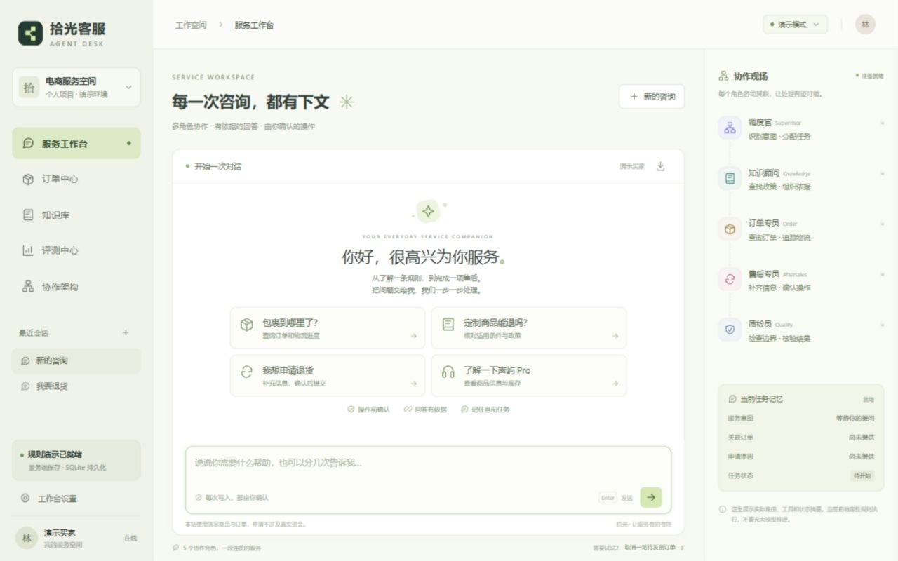
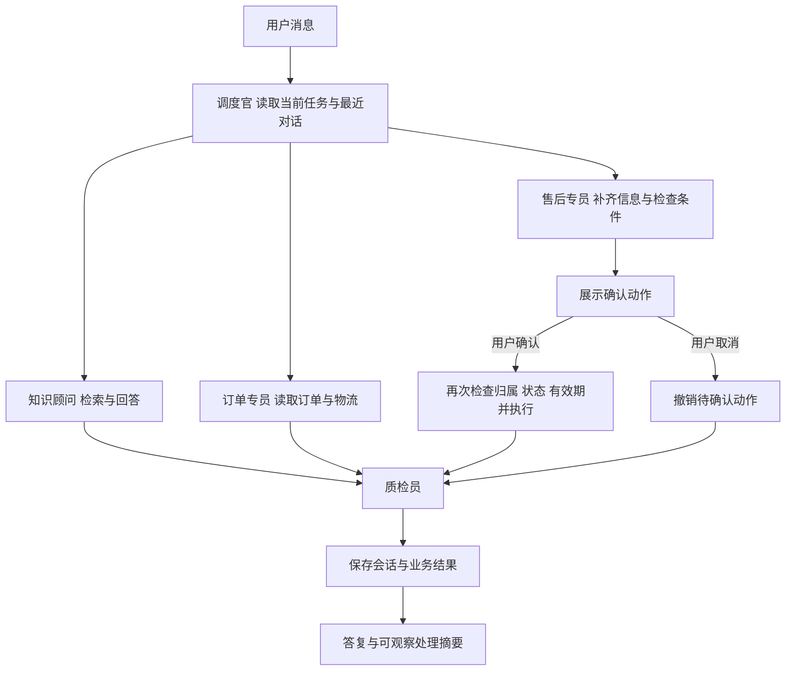

# 拾光客服 Shiguang Agent Desk

一个可运行、可查看协作记录的多智能体电商客服项目。支持政策问答、订单物流、分轮售后信息收集、确认提交和人工协助演示工单，适合学习、产品方案验证和项目展示。



## 先运行起来

需要 **Node.js 22.13 或以上版本**。项目没有第三方运行依赖，无需安装Python、数据库服务或模型权重。

Windows可以双击根目录的 `start-windows.cmd`，保持窗口打开，再访问：

```text
http://127.0.0.1:3188
```

也可以在项目目录运行：

```bash
npm start
```

默认采用确定性规则演示，无需API Key。可直接体验：

```text
我要退货
SG10002
杯子破损，有质量问题
```

然后点击“确认退货申请”。订单中心的售后申请中应出现一条 `requested / 待审核` 记录。确认前不应出现申请。

## 已实现的功能

- 多轮任务状态：保留当前意图、订单号、原因和任务阶段，支持分轮补充、修改与撤销。
- 五角色协作：调度官、知识顾问、订单专员、售后专员、质检员，各有独立模块和职责。
- 知识检索：中文二元词元、BM25式词面评分、业务标签通道与RRF融合，返回可打开的政策原文。
- 订单工具：查询订单、模拟物流、商品价格与库存；检查订单归属。
- 售后工具：退货申请、未发货退款申请、取消订单；检查条件、状态和重复操作。
- 操作确认：15分钟有效期，绑定会话与动作；执行前重新检查订单版本，支持撤销和幂等。
- 人工协助：实际保存演示工单和咨询摘要，可在订单中心查看。
- 工作台：聊天、订单、知识库、评测中心、协作架构、导出与数据重置。
- 两种持久化：本地服务端SQLite；GitHub Pages使用浏览器localStorage。
- 可选真实模型：服务端模型辅助意图识别、依据生成和独立质检；业务操作仍由确定性工具控制。
- 自动测试：核心状态、接口、归属、确认、撤销、幂等与降级路径；网页内另有12组可运行回归。

## 两种运行方式

| 运行方式 | 适合场景 | 数据保存 | 模型能力 |
| --- | --- | --- | --- |
| `npm start` 本地服务 | 完整项目体验、开发与模型接入 | 本机 `data/workspace.db` | 默认规则，可配置真实模型 |
| GitHub Pages静态站 | 公开项目演示链接 | 访问者当前浏览器 | 规则演示，不接收模型密钥 |

GitHub仓库链接用于看代码；启用GitHub Pages后另有可操作的网站链接。Pages本身不运行Node服务端。两种方式复用同一套核心任务引擎。

## 上传GitHub并获得链接

详细的逐步说明见 [GitHub上传与网站部署](docs/GITHUB部署说明.md)。推荐仓库名：`shiguang-agent-desk`。

1. 在GitHub创建一个空仓库。
2. 上传本项目的完整源码，保留 `.github/workflows/pages.yml`。
3. 仓库进入 **Settings → Pages → Build and deployment → Source → GitHub Actions**。
4. 将源码推送到 `main`，或手动运行 **Actions → Deploy demo to GitHub Pages**。
5. 工作流成功后，在Pages设置或Actions部署结果中复制真实网站地址。

源码已经包含测试、静态打包与Pages部署工作流，不需要把密钥提交到GitHub。首次上传后仍需由仓库所有者启用Pages；本交付没有替你创建或发布远程仓库。

## 接入真实模型

本项目使用通用Chat Completions兼容HTTP接口，默认配置参考DeepSeek官方文档。只在本地或部署的Node服务端配置；GitHub Pages演示不启用模型。

1. 复制 `.env.example` 为 `.env`。
2. 根据自己的服务填写：

```dotenv
MODEL_ENABLED=true
MODEL_BASE_URL=https://api.deepseek.com
MODEL_NAME=deepseek-flash
MODEL_API_KEY=在本机填写你自己的密钥
MODEL_ACCESS_CODE=设置自己的访问口令
```

3. 重启 `npm start`。界面顶部会显示模型名称。配置了访问口令时，在“工作台设置”中输入口令；这里只接受访问口令，不接受API Key。

模型职责分别是意图分析、政策回答和独立质检，使用各自提示词。订单与售后模块执行确定性业务校验；模型不能跳过用户确认直接写入。模型输出异常时降级到规则或政策原文。

本交付未使用真实密钥发起付费调用。已验证的是接口结构、模拟模型分支、失败降级和完整规则流程；不同服务商的模型名称、JSON格式支持和实际效果需配置后复核。模型返回的成功调用用量按各阶段汇总；没有返回usage的调用无法精确计费。

API参考：[DeepSeek Chat Completions](https://api-docs.deepseek.com/api/create-chat-completion/)。模型名称可以在 `.env` 中修改，不应把默认名当成永久保证。

## 项目结构

```text
index.html                    网站入口
web/
  app.mjs                     页面、交互和状态展示
  styles.css                  桌面与手机布局
  transport.mjs               服务端与浏览器演示适配
core/
  engine.mjs                  编排与共享任务状态
  catalog.mjs                 演示商品、订单和11份政策
  retrieval.mjs               词面检索与业务标签融合
  agents/
    intent.mjs                调度与信息提取
    knowledge.mjs             检索与依据回答
    order.mjs                 订单与商品工具
    aftersales.mjs            条件、确认、执行和撤销
    quality.mjs               输出核验和模型降级
  evaluation.mjs              网页内12组规则回归
server/
  index.mjs                   HTTP、会话与接口
  store.mjs                   SQLite持久化与并发版本检查
  model.mjs                   服务端模型适配器
tests/                        自动测试
scripts/                      语法检查、Pages打包与预览
.github/workflows/pages.yml    自动检查与部署
docs/                         上传说明、产品讲解和验证记录
```

## 处理流程



“多智能体”在这里指分工明确、共享状态的专家工作流。默认规则模式没有调用大模型；启用模型后也不是五个LLM同时自由协商，订单和售后工具仍由程序约束。项目未使用LangGraph、向量Embedding或向量数据库，不应将这些技术写进本项目的已实现能力。

## 演示订单

| 订单号 | 商品 | 初始状态 | 适合演示 |
| --- | --- | --- | --- |
| SG10001 | 声屿 Pro 降噪耳机 | 已发货 | 查物流，拒绝直接取消 |
| SG10002 | 拾光定制陶瓷杯 | 已签收，创建空间时向前12天 | 质量退货、多轮补全、确认提交 |
| SG10003 | 日常系列纯棉T恤 | 已付款未发货 | 取消订单、退款申请和确认撤销 |

内部测试另设一笔其他买家的订单，用于检查归属边界，不会返回到当前买家的订单列表。

## 检查与构建

```bash
npm run check
npm test
npm run build
node scripts/preview-pages.mjs
```

最后一条会在 `http://127.0.0.1:3189` 启动纯静态演示，用于检查GitHub Pages版本。`dist/`只包含网站需要的 `index.html`、`web/`、`core/` 和图标，不包含服务端、数据库或 `.env`。

## 能力边界

这是个人原型与学习项目，不是已接入真实电商的生产系统。商品、订单、物流和政策均为演示；工单可保存，但没有真实座席接入；申请可创建，但没有支付、审批和退货承运商集成，也不支持凭证上传。规则模式对未覆盖表达可能识别失败，中文词面检索不等于语义向量检索。

服务端用不可猜测的浏览器会话Cookie隔离演示空间，不等于完整买家账号认证。当前不支持跨设备账号同步、生产级用户权限、分布式部署和全局模型费用上限。对外部署服务端前应按实际业务补齐身份、监控、限额和数据治理。

网页里的12组结果是预设规则回归，不能作为独立模型准确率或真实业务增长。面试时应以你实际理解、修改和验证的部分描述个人贡献，参见 [产品设计与面试讲解](docs/产品设计与面试讲解.md)。


